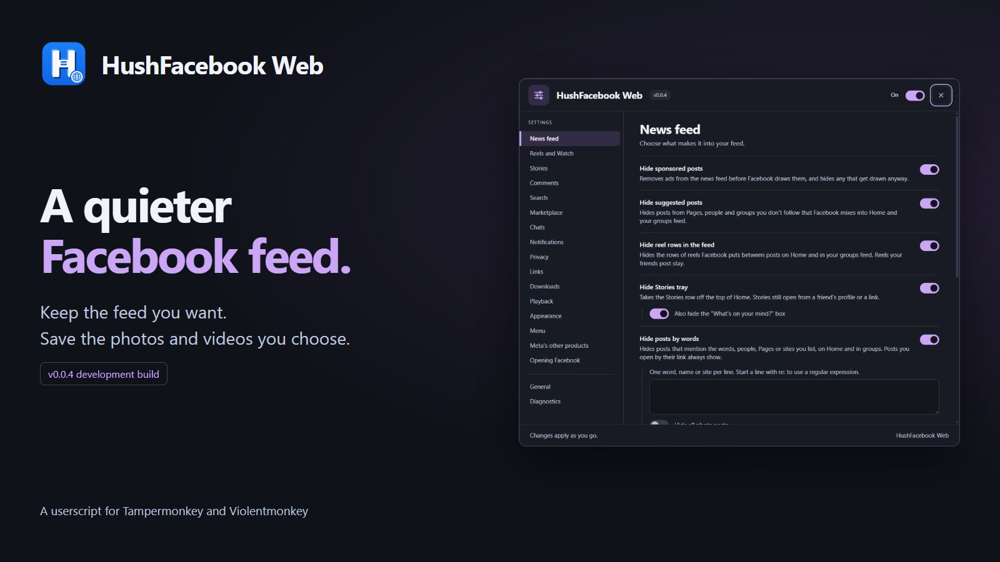
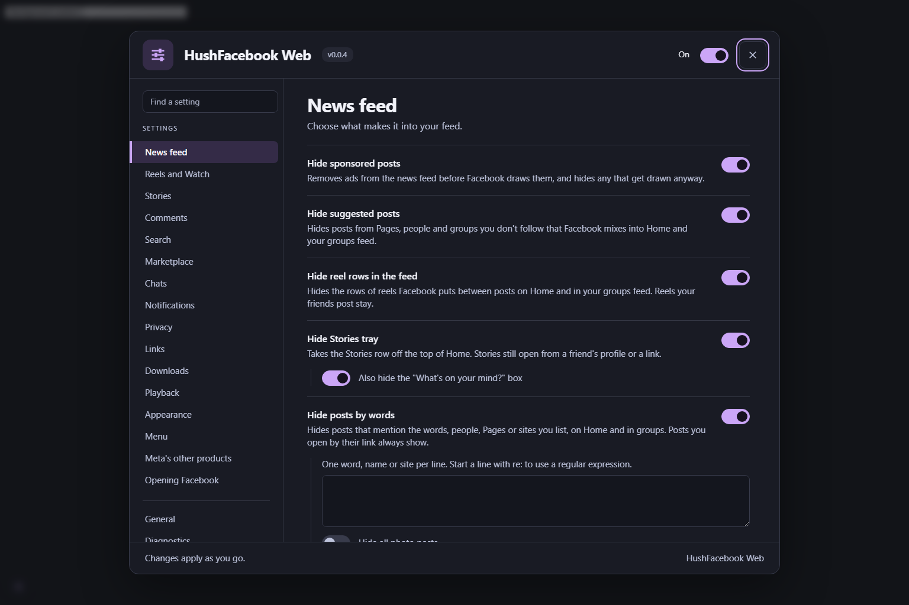
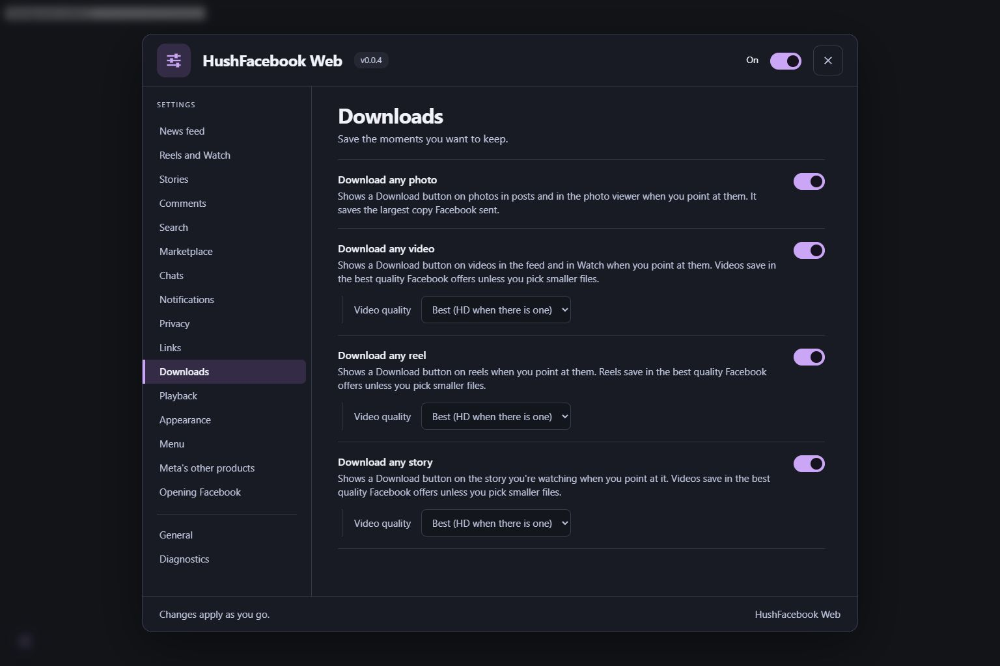

<p>
  
  <a href="LICENSE"></a>
  
  
</p>

<p>
  <a href="https://ko-fi.com/X8K126YVER">
    
  </a>
</p>

# HushFacebook Web

HushFacebook Web is a userscript for Facebook in a desktop browser. It's the web sibling of [Hushfacebook](https://github.com/SysAdminDoc/HushFacebook), the patch bundle for the Android app, and it's working toward the same list: a feed without ads or suggested posts, less Meta AI, downloads, privacy switches and playback controls.

## Where it stands

This is the very start. Version 0.0.1 is the first release.

It has the groundwork in place, meaning the settings panel and the layer that reads Facebook's data as it loads, plus these features:

* Hide sponsored posts
* Hide suggested posts
* Hide reel rows in the feed
* Hide Stories tray
* Hide posts by words
* Hide seen posts
* Hide AI-detected posts
* Show full post dates
* Keep your place in the feed
* Hide sponsored reels
* Don't send watch history
* Hide sponsored search results
* Hide sponsored Marketplace listings
* View profile on Marketplace sellers
* Hide read receipts
* Hide typing indicator
* Hide kinds of notifications
* Default comment order
* Show every reply
* Hide GIF and sticker buttons
* Hide that you're writing a comment
* Tag suggestions only after @
* Show comments as written
* View stories anonymously
* Stop stories moving on
* Sanitize sharing links
* Skip Facebook's link redirect
* Download any photo, video, reel or story
* Following feed on Home
* Open on a chosen tab
* Marketplace only
* Tap to play
* Turn off HDR brightness
* Resume long videos
* Keep your video speed
* Hold a reel for 2x
* Picture-in-picture button
* Keep video controls on screen
* Default video quality
* Force dark mode
* AMOLED black theme
* Accent color
* Use the system font
* Use your computer's emoji
* Turn off screen transitions
* Hide tabs
* Hide tab badges
* Hide Menu promotions
* Hide Meta upsells
* Hide Facebook's own cards and tips
* Custom CSS
* Settings in your account menu

All of them have run on facebook.com in a test browser, though a few haven't had anything to act on yet. The test account hasn't been shown a feed ad or a row of reels, so those switches have only been seen leaving ordinary posts alone. The feed has only offered reels to download so far, not plain videos. The test account's chats are all end-to-end encrypted, which the read receipt and typing switches can't reach, so they haven't had anything to hold back yet. The script has also been installed in Tampermonkey and in Violentmonkey on Chrome, and in both it runs in the page, takes Marketplace and search ads out, gives Copy link the post's own address, keeps story views to yourself and remembers its settings. The other features haven't been tried in either manager yet.

[docs/feature-parity.md](docs/feature-parity.md) goes through every Hushfacebook patch and says what the web version will do with it.

## The settings panel

Click the sliders button in the bottom left corner of Facebook, or the HushFacebook Web row in the menu under your profile picture at the top right. Your userscript manager's menu has a HushFacebook Web settings entry too. Changes save as you make them, and every switch has a line under it saying what it does. If you'd rather not have the corner button, turn it off under Menu or General.

<p>
  
  
</p>

## How it works

Most Facebook cleanup tools hunt for posts on the page and hide them. That breaks whenever Facebook reshuffles its markup, which is often. HushFacebook Web works a layer lower where it can. Facebook's site loads its feed as data, both inline with the page and in the background as you scroll, and the script removes ads from that data before Facebook draws anything. The aim is no gap where an ad was and no flash of it on screen.

Some things can only be done on the page itself, like download buttons or hiding a menu item. Those use the page, kept to the parts of Facebook's markup that change least.

Nothing leaves your browser. The script doesn't talk to any server, and your settings stay in your userscript manager, kept apart for each Facebook account you sign in with.

## Install

You'll need a userscript manager first:

* [Tampermonkey](https://www.tampermonkey.net/) or [Violentmonkey](https://violentmonkey.github.io/) in Chrome, Edge, Firefox or another desktop browser. It's been checked in both on Chrome. Firefox hasn't been checked yet.
* In Chrome 138 or newer, open the manager's extension details and turn on **Allow User Scripts**. Chrome won't run any userscript without it.

Then open [hushfacebook-web.user.js](https://github.com/SysAdminDoc/HushFacebookWeb/releases/latest/download/hushfacebook-web.user.js) and your manager will offer to install it. It checks for updates on its own.

Open the settings from the round button in Facebook's bottom-left corner, from the menu under your profile picture, or from your userscript manager's menu.

## Building it yourself

You need Node 24.

```
npm install
npm run build
```

That writes `dist/hushfacebook-web.user.js`. Open it in your userscript manager to install it. `npm test` runs the tests and `npm run check` runs the lint and version checks. [CONTRIBUTING.md](CONTRIBUTING.md) explains how the code is laid out.

## Thanks

These projects showed what works on Facebook's site and what doesn't: [FB Clean my feeds](https://github.com/Artificial-Sweetener/facebook-clean-my-feeds), [Social Fixer](https://www.socialfixer.com/), [F.B. Purity](https://www.fbpurity.com/), uBlock Origin's Facebook filters, [Privacy Badger](https://github.com/EFForg/privacybadger) and [ClearURLs](https://github.com/ClearURLs/Rules). HushFacebook Web is written from scratch and doesn't include their code.

## License

[MIT](LICENSE)
