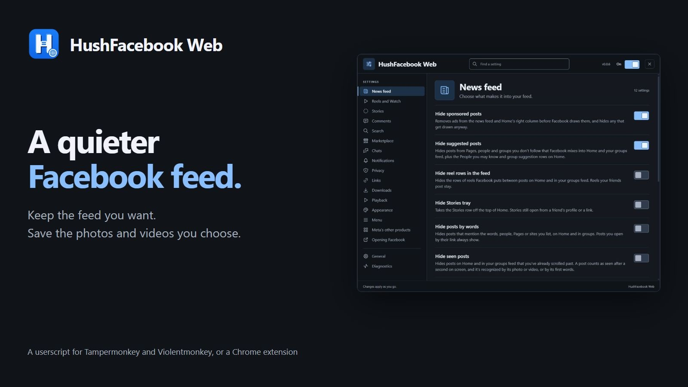
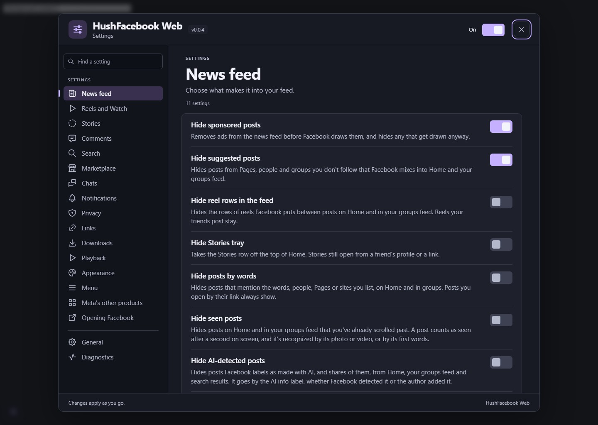
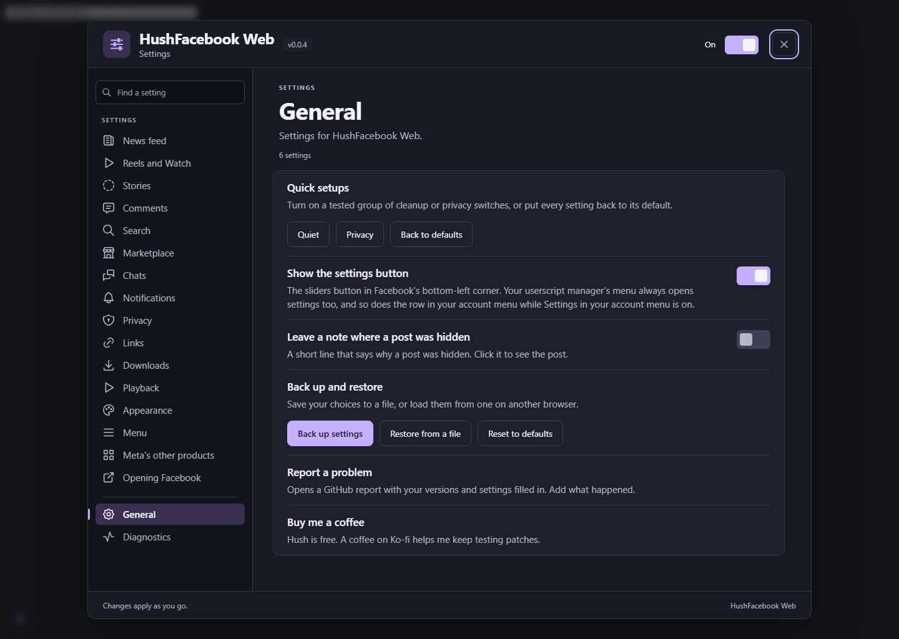

<p>
  
  <a href="LICENSE"></a>
  
  
</p>

<p>
  <a href="https://ko-fi.com/X8K126YVER">
    
  </a>
</p>

# HushFacebook Web

HushFacebook Web is a userscript for Facebook in a desktop browser, and a Chrome extension built from the same code. It's the web sibling of [Hushfacebook](https://github.com/SysAdminDoc/HushFacebook), the patch bundle for the Android app, and it's working toward the same list: a feed without ads or suggested posts, less Meta AI, downloads, privacy switches and playback controls.

It's still early. The current development build is 0.0.4 and the latest published release is 0.0.2. What changed in each build is in the [changelog](CHANGELOG.md), and [docs/feature-parity.md](docs/feature-parity.md) goes through every Hushfacebook patch and says what the web version does with it.

## Install

There are two ways to run it. They share every feature, so pick one, not both.

### As a userscript

1. Install [Tampermonkey](https://www.tampermonkey.net/) or [Violentmonkey](https://violentmonkey.github.io/) in Chrome, Edge, Firefox or another desktop browser. Both have been checked in Chrome. Firefox hasn't been checked yet.
2. In Chrome 138 or newer, open the manager's extension details and turn on **Allow User Scripts**. Chrome won't run any userscript without it.
3. Open [hushfacebook-web.user.js](https://github.com/SysAdminDoc/HushFacebookWeb/releases/latest/download/hushfacebook-web.user.js) and your manager will offer to install it. It checks for updates on its own.

### As a Chrome extension

Works in Chrome, Edge, Brave and other Chromium browsers from version 111, with no userscript manager and no Allow User Scripts switch to find.

1. Download `hushfacebook-web-extension.zip` from a release and unzip it somewhere you'll keep it.
2. Open `chrome://extensions` (`edge://extensions` in Edge) and turn on **Developer mode**.
3. Click **Load unpacked** and pick the unzipped folder.

The extension is new in the development build, so the first release to carry the zip is the one after 0.0.2. Until then, build it yourself (below) and load `dist/extension`.

A loaded-unpacked extension can't update itself, so once a day it asks GitHub for the latest release. When there's a newer one, the toolbar button shows NEW, Facebook shows a one-time note, and General in the settings says how to update: unzip the new release over the same folder and click Reload on the extensions page. Your settings stay. The extension asks for storage (your settings), downloads (saving photos and videos), alarms (the daily release check) and the tab you click its button on. It runs only on facebook.com and in Instant Games frames, and the only other place it contacts is GitHub's release API.

## Settings

Press and hold the Facebook logo at the top left to open settings. You can also click the sliders button in the bottom left corner or use the HushFacebook Web row in the menu under your profile picture. Your userscript manager's menu has a settings entry too, and in the extension the toolbar button opens them from any tab. Settings use a dark panel with a section sidebar, grouped controls and lavender switches. Changes save as you make them, and every switch has a line under it saying what it does. If you'd rather not have the corner button, turn it off under Menu or General.

**Find a setting** at the top searches every row as you type, including General and nested choices. The controls work in the results. The power switch pauses the script. When a choice needs a reload, a Reload row appears and brings you back to the same settings page afterward.

General has Quiet and Privacy Quick setups, and each one reports how many settings changed. Back to defaults resets everything in one click. You can also back up or restore a settings file up to 1 MB, open a filled problem report on GitHub, or use the Ko-fi link. Each Facebook account gets its own set of settings.

<p>
  
  
</p>

### What it can do

Every switch starts off except the ones that only remove things nobody asked for.

- **News feed:** Hide sponsored posts, Hide suggested posts, Hide reel rows in the feed, Hide Stories tray, Hide posts by words, Hide seen posts, Hide AI-detected posts, Show full post dates, Keep your place in the feed, Hide Follow and Join buttons, Expand long posts.
- **Reels:** Hide sponsored reels, Don't send watch history, Clean up Reels, Hold a reel for 2x.
- **Search and Marketplace:** Hide sponsored search results, Hide sponsored Marketplace listings, View profile on Marketplace sellers, Marketplace only.
- **Messages and privacy:** Hide read receipts, Hide typing indicator, Hide that you're writing a comment, View stories anonymously, Hold back usage logs, Sanitize sharing links, Skip Facebook's link redirect, Trim the share menu, Open Messenger as a full page. (Read receipt and typing switches can't reach end-to-end encrypted chats.)
- **Comments:** Default comment order, Show every reply, Hide GIF and sticker buttons, Tag suggestions only after @, Show comments as written.
- **Notifications and navigation:** Hide kinds of notifications, Following feed on Home, Open on a chosen tab, Hide tabs, Hide tab badges.
- **Downloads:** Download any photo, video, reel or story.
- **Playback:** Tap to play, Turn off HDR brightness, Resume long videos, Keep your video speed, Remember your volume, Picture-in-picture button, Keep video controls on screen, Default video quality, Stop stories moving on.
- **Appearance:** Force dark mode, AMOLED black theme, Accent color, Use the system font, Use your computer's emoji, Turn off screen transitions, Custom CSS.
- **Meta's other products:** Hide Menu promotions, Hide Meta upsells, Hide Facebook's own cards and tips, Block Instant Games ads (experimental: it answers supported ad requests with the game's usual no-ad response, so rewards that need an ad won't be earned, and it needs manager storage and page mode).
- **Menu:** Settings in your account menu.

## How it works

Most Facebook cleanup tools hunt for posts on the page and hide them. That breaks whenever Facebook reshuffles its markup, which is often. HushFacebook Web works a layer lower where it can. Facebook loads its feed as data, both inline with the page and in the background as you scroll, and the script removes ads from that data before Facebook draws anything. No gap where an ad was, no flash of it on screen.

Some things can only be done on the page itself, like download buttons or hiding a menu item. Those use the parts of Facebook's markup that change least.

Downloads request only the media you choose to save. Diagnostics reports include changed settings and recent log details, so read them before sharing. If a manager has no storage of its own, the script falls back to page storage, which Facebook may clear.

## Building it yourself

You need Node 24.

```
npm install
npm run build
```

That writes `dist/hushfacebook-web.user.js`, which you open in your userscript manager to install, plus the extension unpacked in `dist/extension` and zipped as `dist/hushfacebook-web-extension.zip`. `npm test` runs the tests and `npm run check` runs the lint and version checks. [CONTRIBUTING.md](CONTRIBUTING.md) explains how the code is laid out.

## Thanks

These projects showed what works on Facebook's site and what doesn't: [FB Clean my feeds](https://github.com/Artificial-Sweetener/facebook-clean-my-feeds), [Social Fixer](https://www.socialfixer.com/), [F.B. Purity](https://www.fbpurity.com/), uBlock Origin's Facebook filters, [Privacy Badger](https://github.com/EFForg/privacybadger) and [ClearURLs](https://github.com/ClearURLs/Rules). HushFacebook Web is written from scratch and doesn't include their code. Settings navigation uses [Tabler Icons](https://github.com/tabler/tabler-icons) under the MIT license.

## License

[MIT](LICENSE)
